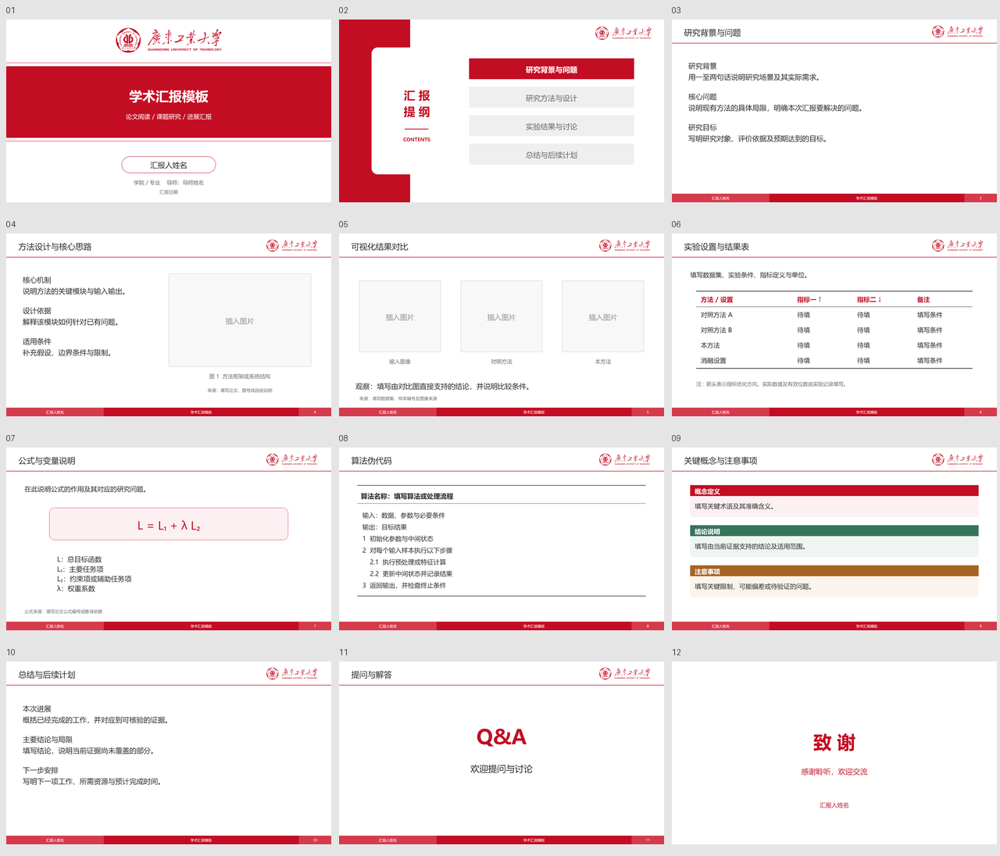

# 广东工业大学个人学术汇报模板

基于 [GrokCV/TemplateNKU](https://github.com/GrokCV/TemplateNKU) 的学术版式，替换为广东工业大学官方校徽和广工红 `#C30D23`，同时提供可编辑 PowerPoint 与 LaTeX Beamer。个人衍生模板，非学校官方发布。



## 直接使用

- **PowerPoint**：打开 [GDUT-Template.pptx](assets/powerpoint/GDUT-Template.pptx) 修改，或用 [GDUT-Template.potx](assets/powerpoint/GDUT-Template.potx) 新建演示文稿。文字、线框和表格均为可编辑对象，校徽为官方图像。
- **Beamer**：编辑 `assets/beamer/profile.tex` 的个人信息和 `main.tex` 的内容，用 XeLaTeX 编译。可从 `starter.tex` 的精简稿开始。
- **预览**：[Beamer PDF](previews/GDUT-Beamer-Template.pdf)。

也可以一次创建个人副本：

```bash
python scripts/init_deck.py --output my-report --format both --title "汇报题目" --name "你的姓名" --college "学院 / 专业" --supervisor "导师姓名" --date "汇报日期"
python scripts/build_beamer.py my-report/beamer/main.tex --render
```

默认占位字段集中在初始化参数和 Beamer 的 `profile.tex`，无需修改主题代码。脚本要求Python 3.9及以上；Beamer构建另需XeLaTeX，渲染另需PyMuPDF。未使用shell escape，不捆绑字体。

## 作为 Codex skill 使用

把本目录复制到 `~/.codex/skills/gdut-presentation-skill/`，重新打开会话后调用：

> 使用 $gdut-presentation-skill，依据我的材料制作广工风格的学术汇报，同时交付可编辑PPTX和Beamer PDF。

skill 的入口是 [SKILL.md](SKILL.md)。它会复用模板、填写个人字段并检查输出，不会自动上传或发布报告。PowerPoint和Beamer是独立源码，修改后不会自动互相同步。

## 来源

广工红的官方印刷基准为CMYK 15/100/90/10；屏幕色`#C30D23`取自官方校徽素材的实色。来源与使用边界见 [素材来源](references/sources.md) 和 [NOTICE](NOTICE.md)。本仓库未对上游模板及学校标识宣称开放许可。
